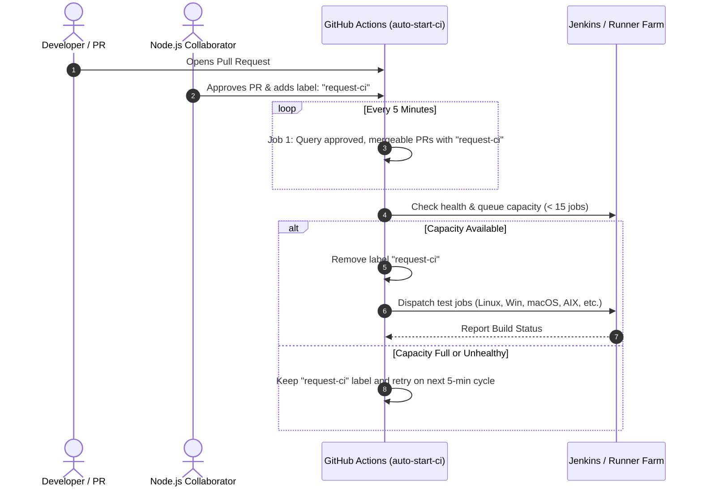
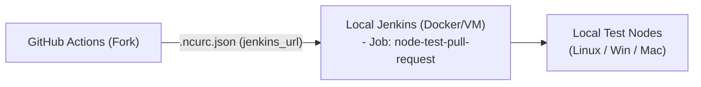
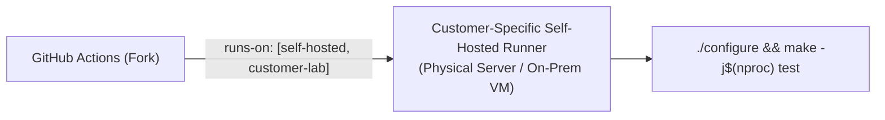

# Auto Start CI: Architecture, Upstream Operations & Runner Guide

## Executive Summary

| Topic | Key Finding / Recommendation |
| :--- | :--- |
| **Pipeline Purpose** | Automatically scans open pull requests for CI approval labels (`request-ci`, `resume-ci`), checks whether the build cluster is available and below workload capacity, and triggers comprehensive testing across platforms. |
| **Upstream Operating Cost** | **$0.00 / year** in commercial software subscriptions. The Jenkins controller, mainframes (AIX, s390x), and cloud VMs are 100% sponsored and donated in-kind to the OpenJS Foundation. |
| **Need for Big Modifications?** | **NO.** Running this workflow on either **Local Jenkins** or **Customer-Specific Self-Hosted Runners** does **not** require architectural re-engineering or big modifications. It only requires adjusting target credentials and routing (~5 to 10 configuration lines). |
| **Fork Deployment Cost** | **$0.00 / year** using free open-source Jenkins or native GitHub Actions self-hosted runners. |

---

## 1. What This Pipeline Does

The `auto-start-ci.yml` pipeline functions as an **automated queue controller and test dispatcher**. 

In high-volume repositories like Node.js (hundreds of PRs each week), running deep cross-platform integration tests on every commit push would overwhelm hardware clusters. Instead, the project requires collaborator approval before triggering broad tests.



### Detailed Step-by-Step Flow:
1. **Queue Inspection (`get-prs-for-ci`)**:
   - Runs every 5 minutes on a GitHub-hosted runner (`ubuntu-latest` / `ubuntu-slim`).
   - Uses the GitHub CLI (`gh pr list`) to query open pull requests that meet three criteria:
     - State is approved (`review:approved`).
     - Labeled with `request-ci` or `resume-ci`.
     - Git merge status is conflict-free (`mergeable == "MERGEABLE"`).
   - Groups matching PR numbers into a batch (default up to 5 PRs).

2. **Cluster Health & Workload Throttling (`start-ci`)**:
   - For each matching PR, executes `tools/actions/start-ci.sh`.
   - Probes the build cluster via `@node-core/utils` (`ncu-ci available` and `ncu-ci workload`).
   - If the queue exceeds `MAX_WORKLOAD` (default 15 active jobs) or the cluster is offline, the workflow gracefully defers execution to the next cycle without modifying labels.

3. **Execution & State Management**:
   - Removes the `request-ci` / `resume-ci` label to prevent duplicate triggers.
   - Dispatches the test job (`ncu-ci run --check-for-duplicates "$pr"`).
   - If the trigger fails, applies `request-ci-failed` and automatically posts a formatted error log comment directly on the PR.

---

## 2. How Upstream Operates & Funds It

### 2.1 Zero Commercial Subscriptions
The upstream Node.js project and the OpenJS Foundation pay **$0.00** in commercial software subscriptions for this workflow:
- **GitHub Actions**: Standard runners are provided completely free with unlimited minutes for public open-source projects under GitHub's Open Source program.
- **Jenkins Controller & Software**: Uses the free, open-source Community Edition of Jenkins (no CloudBees or paid licenses).
- **Tooling**: `@node-core/utils` is an in-house open-source tool developed by Node.js maintainers.

### 2.2 In-Kind Hardware & Cloud Sponsorships
The upstream build farm ([`ci.nodejs.org`](https://ci.nodejs.org/)) tests esoteric enterprise platforms across hardware donated by foundation partners:

| Platform / Component | In-Kind Hardware Provider | Model | Upstream Cost |
| :--- | :--- | :--- | :--- |
| **Jenkins Master & Web Controllers** | **DigitalOcean** | Cloud Droplets / VMs | **$0.00** (Sponsored) |
| **IBM AIX & z/OS (s390x) Mainframes** | **IBM** | Dedicated LPARs & mainframes | **$0.00** (Donated) |
| **PowerPC (ppc64le)** | **IBM / Oregon State University (OSU OSL)** | Dedicated hardware | **$0.00** (Donated) |
| **ARM64 Servers** | **Arm & Equinix Metal (Packet)** | Bare-metal compute | **$0.00** (Donated) |
| **macOS Build Farm** | **MacStadium** | Dedicated Mac minis | **$0.00** (Donated) |
| **Windows VM Farm** | **Microsoft Azure** | Cloud compute credits | **$0.00** (Donated) |
| **Enterprise CDN & DDoS** | **Cloudflare** | Enterprise caching | **$0.00** (Donated) |

---

## 3. Modifications Required for Fork Implementations

### Direct Question: "Should I do any big modification if run on customer-specific self-hosted runners or local Jenkins?"

### Answer: **NO big modifications are required.**
You do **not** need to rewrite the architecture, redesign test scripts, or license expensive orchestration platforms. The core logic remains intact; you only adjust endpoint URLs and credentials.

---

### Scenario A: Running on Local Jenkins

If your team wants to retain the exact upstream Jenkins workflow:



#### What Modifications are Needed? (Very Small — < 10 lines)
1. **Remove Upstream Hardcoded Guard**:
   In `.github/workflows/auto-start-ci.yml`, change:
   ```yaml
   # BEFORE (Upstream only)
   if: github.repository == 'nodejs/node'

   # AFTER (Your Fork)
   if: github.repository == 'your-org/node' || github.event_name == 'workflow_dispatch'
   ```
2. **Configure Your Jenkins Endpoint**:
   Create or edit `.ncurc.json` in the root (or configure via environment variable):
   ```json
   {
     "jenkins_url": "https://jenkins.mycompany.internal"
   }
   ```
3. **Add Repository Secrets in GitHub**:
   - `JENKINS_USER`: Username of an account on your local Jenkins.
   - `JENKINS_TOKEN`: API token generated in Jenkins user settings.
4. **Create One Jenkins Job**:
   - In your local Jenkins, create a job named `node-test-pull-request`.
   - Configure it to take string parameter `PR_ID` and execute:
     ```bash
     ./configure
     make -j$(nproc) test
     ```
* **Effort Required**: ~1 to 2 hours of setup.
* **Software Cost**: **$0.00**.

---

### Scenario B: Running on Customer-Specific Self-Hosted Runners (GitHub Actions Native)

If you do not want to maintain a Jenkins server and prefer running directly on **customer-specific self-hosted physical machines or VMs**:



#### What Modifications are Needed? (Simplification — removes Jenkins entirely)
Instead of dispatching to an external Jenkins API, the workflow dispatches directly to GitHub Actions runners tagged with customer-specific labels.

1. **Option 1: Native Label-Triggered Workflow (Recommended)**
   Add a GitHub Actions workflow `.github/workflows/test-customer-runners.yml`:
   ```yaml
   name: Customer Platform CI
   on:
     pull_request:
       types: [labeled, synchronize]

   jobs:
     test:
       if: contains(github.event.pull_request.labels.*.name, 'request-ci')
       runs-on: [self-hosted, customer-platform]
       steps:
         - uses: actions/checkout@v4
         - name: Build and Test
           run: |
             ./configure
             make -j$(nproc) test
   ```
2. **Option 2: Minimal Modification to `start-ci.sh`**
   If you want to keep the 5-minute queue polling logic in `auto-start-ci.yml`, modify only lines 60–70 in `tools/actions/start-ci.sh`:
   ```bash
   # Replace the ncu-ci Jenkins call with GitHub CLI dispatch:
   gh workflow run test-customer.yml --ref "$pr_branch"
   ```
* **Effort Required**: ~2 to 4 hours (mostly installing the GitHub runner service on the customer machine).
* **Software Cost**: **$0.00** (GitHub self-hosted runner daemon is free and open-source).

---

## 4. Comparison Table: Local Jenkins vs. Self-Hosted Runners

| Evaluation Metric | Option 1: Local Jenkins | Option 2: Self-Hosted GitHub Runners (Preferred) |
| :--- | :--- | :--- |
| **Modification Scope** | **Minimal** (Set 2 secrets + Jenkins URL) | **Low** (Configure `runs-on: [self-hosted]`) |
| **External Servers Needed** | Yes (Dedicated Jenkins Master VM/Container) | **None** (GitHub Actions coordinates everything) |
| **Maintenance Overhead** | Requires maintaining Jenkins plugins, OS updates, backups | **Zero** (Runner auto-updates via GitHub daemon) |
| **Software Licensing Cost** | **$0.00** (Open Source) | **$0.00** (Included with GitHub) |
| **Platform Support** | Any OS (AIX, z/OS, Linux, Win, macOS) | Linux (x64/ARM), Windows, macOS |
| **Suitability for Enterprise Fork** | Best if customer requires esoteric mainframes (AIX) | **Best for standard Linux/Windows/ARM environments** |

---

## 5. Conclusion & Decision Matrix

1. **Upstream Reality**: Upstream Node.js pays **$0** for subscriptions because GitHub Actions provides free open-source runners and hardware partners donate all physical nodes.
2. **The $1,200 Cost in Planning Tables**: This was purely a theoretical planning reserve in case a customer contractually demanded dedicated cloud mainframe hosting (such as IBM AIX cloud instances). For standard Linux, Windows, macOS, and ARM64 platforms, the real cost is **$0.00**.
3. **Implementation Verdict**:
   - If your fork only needs standard servers: Use **Customer-Specific Self-Hosted GitHub Runners**. It requires **zero big modifications**, eliminates the need to run Jenkins, and costs **$0.00**.
   - If you already have a team Jenkins instance: Connect `auto-start-ci` in under 15 minutes by adding your Jenkins URL and credentials.
