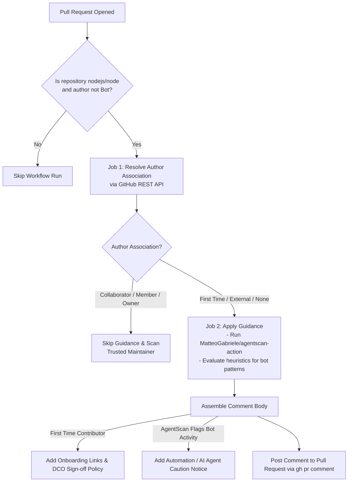
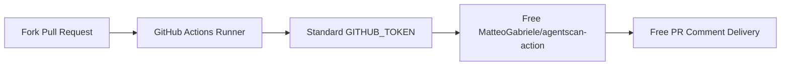

# Contributor Guidance: Architecture, Upstream Operations & Cost Analysis

## Executive Summary & Direct Q&A

| Question | Short Answer | Details / Section |
| :--- | :--- | :--- |
| **What does this pipeline do?** | Automated community triage & contributor onboarding | Scans newly opened PRs, resolves contributor trust level, checks for bot/AI spam using AgentScan heuristics, and posts onboarding guidance or automation cautions. (See [Section 1](#1-what-this-pipeline-does)) |
| **How does upstream run it?** | Event-driven on GitHub Actions (`pull_request_target`) | Triggers on PR creation, evaluates author association via GitHub REST API, runs `MatteoGabriele/agentscan-action`, and comments via `gh pr comment`. (See [Section 2](#2-how-upstream-vendor-runs-this-pipeline)) |
| **How much is upstream paying?** | **$0.00 / year** | Zero software subscriptions. GitHub Actions provides free runtime for public open-source repos, and AgentScan is 100% free open-source software (MIT License). (See [Section 3](#3-upstream-costs-subscriptions--vendor-details)) |
| **Why was $1,188 in the planning table?** | Historical conservative placeholder | An earlier rough commercial ceiling assumption ($99/mo) before verifying that AgentScan is an open-source MIT GitHub Action with no commercial SaaS tier. (See [Section 5](#5-cost-table-reconciliation--explanation-of-the-1188-figure)) |
| **Can I run it in a forked repo for $0?** | **YES ($0.00)** | Works out-of-the-box by adjusting the repository name check and using the standard built-in `GITHUB_TOKEN`. (See [Section 4](#4-zero-cost-fork-implementation-guide)) |
| **Can we skip this in an open-source release fork?** | **YES, 100% SKIPPABLE** | It is classified as `Utility` / `Mandatory: No`. It produces zero build artifacts, runs zero tests, and has zero impact on compiled Node.js release binaries. (See [Section 6](#6-can-we-skip-this-pipeline-in-an-opensource-release-model)) |

---

## 1. What This Pipeline Does

The `contributor-guidance.yml` pipeline serves as an automated **community triage gatekeeper and onboarding guide** for incoming pull requests.

In large open-source projects like Node.js that receive thousands of external contributions from the public internet, maintainers need automated tools to:
1. Welcome first-time human contributors and inform them of contribution rules (DCO `Signed-off-by` requirement, Code of Conduct, and PR workflows).
2. Detect and flag automated AI spam or bot accounts attempting to submit low-quality, unsupervised pull requests.



### Detailed Execution Sequence:
1. **Event Trigger (`pull_request_target: [opened]`)**:
   - Executes only when a new pull request is opened.
   - Evaluates on `ubuntu-slim` (or standard `ubuntu-latest`).
   - Ignores automated bot accounts (`github.event.pull_request.user.type != 'Bot'`).

2. **Job 1: Resolve Contributor Status (`contributor`)**:
   - Uses the GitHub REST API (`gh api "/repos/$GITHUB_REPOSITORY/pulls/$NUMBER" --jq '.author_association'`).
   - Evaluates author association:
     - If author is **`MEMBER`**, **`COLLABORATOR`**, or **`OWNER`**: Skips the guidance job (`should_scan=false`) because trusted maintainers do not need onboarding guidance or spam detection.
     - If author is **`FIRST_TIMER`** or **`FIRST_TIME_CONTRIBUTOR`**: Sets `is_first_time=true` and `should_scan=true`.
     - If author is **`CONTRIBUTOR`** or **`NONE`** (external public user): Sets `is_first_time=false` and `should_scan=true`.

3. **Job 2: Apply Contributor Guidance (`guidance`)**:
   - **Step 1 (AgentScan)**: Runs `MatteoGabriele/agentscan-action@v2.5.0` to inspect public GitHub activity and detect automated bot patterns.
   - **Step 2 (Assemble & Deliver Comment)**:
     - **Welcome Message**: If `is_first_time == 'true'`, links to the first-time contributor guide, contribution policy, Code of Conduct, and explicitly reminds the contributor that every commit must include a **`Signed-off-by: Name <email>`** DCO line.
     - **Caution Message**: If AgentScan flags the submission (`classification == 'mixed' \|\| classification == 'automation' \|\| community-flagged == 'true'`), it appends a prominent caution callout reminding reviewers and contributors of Node.js automation and AI policies.
     - Delivers the assembled message directly to the PR using `gh pr comment`.

---

## 2. How Upstream Vendor Runs This Pipeline

Upstream Node.js runs this workflow entirely on native GitHub Actions infrastructure:
- **Trigger**: Runs on `pull_request_target` so that the workflow has appropriate permissions to query repository metadata and comment on forks' PRs.
- **Authentication**: Uses `secrets.GH_USER_TOKEN` (a privileged GitHub token) to perform privileged author association queries, and standard `${{ secrets.GITHUB_TOKEN }}` to post comments.
- **Screening Tool**: References the publicly available GitHub Action `MatteoGabriele/agentscan-action@v2.5.0`.
- **Fault-Tolerant Step**: Configured with `continue-on-error: true` on the AgentScan step, ensuring that if external heuristic services fail, the welcome onboarding comment is still delivered without breaking CI.

---

## 3. Upstream Costs, Subscriptions & Vendor Details

### 3.1 Direct Upstream Costs: $0.00 / year
Neither the Node.js project nor the OpenJS Foundation pays any commercial subscription or vendor fees for this pipeline:
- **GitHub Actions Runtime**: Standard runners are provided **free of charge** with unlimited minutes to public open-source projects under GitHub for Open Source.
- **AgentScan Tooling**: The tool used (`MatteoGabriele/agentscan-action`) is an **open-source project licensed under the MIT License** by developer Matteo Gabriele. It is hosted publicly on GitHub and charges no subscription or API usage fees.
- **Commercial SaaS Subscriptions Used**: **NONE ($0.00)**. No enterprise bot-detection licenses, no seat fees, and no third-party SaaS contracts exist for this workflow.

---

## 4. Zero-Cost Fork Implementation Guide

If you wish to run this workflow on a forked repository, you can do so for **$0.00**:



### Minimal Changes Required (Under 5 minutes):
1. **Update Repository Guard**:
   In `.github/workflows/contributor-guidance.yml`, change line 18:
   ```yaml
   # BEFORE (Upstream Only):
   github.repository == 'nodejs/node' &&

   # AFTER (Your Fork):
   github.repository == 'your-org/node' &&
   ```
2. **Use Built-In Token**:
   Replace `secrets.GH_USER_TOKEN` with the standard built-in token:
   ```yaml
   GH_TOKEN: ${{ secrets.GITHUB_TOKEN }}
   ```
3. **Cost**: **$0.00** (Free on public repositories, or included within standard monthly free allowances on private GitHub organizations).

---

## 5. Cost Table Reconciliation & Explanation of the $1,188 Figure

In the initial planning spreadsheet (`workflow-fixes/infra_tool_estimate.xlsx` / `Sheet1`), the following row was recorded:

| Field | Planning Table Value | Verified Reality |
| :--- | :--- | :--- |
| **Pipeline** | `Contributor guidance` (`contributor-guidance.yml`) | Community PR triage workflow |
| **Category** | `Utility` | Auxiliary maintenance script |
| **Mandatory** | `No` | Non-blocking / non-core |
| **Infra / Tool** | `AgentScan upstream` | `MatteoGabriele/agentscan-action` |
| **Yearly Published Cost ($)** | **`0`** | Correct: Published price is $0 |
| **Yearly Cost (Requires Vendor Quote) ($)** | **`1,188`** | **Historical placeholder**: $99/mo commercial assumption |
| **Remarks** | *"AgentScan is not required for controlled customer development. Rough internet/upstream estimate; vendor quote required for actual price."* | Explicitly noted that this tool is unneeded in customer development |
| **Preferred Alternate Cost ($)** | **`0`** | Replaced by manual review / rules |

### Why $1,188 Was Estimated:
Before deep-dive codebase and package verification, initial infrastructure scoping assigned a conservative commercial SaaS ceiling ($99/month = $1,188/year) under the hypothesis that AgentScan was a proprietary commercial bot-detection vendor (like Snyk, SonarCloud, or DataDome). 

**Empirical Verification**: Inspection of the repository and GitHub action source confirms AgentScan is an **MIT-licensed open-source GitHub Action**. The actual vendor quote and published cost is **$0.00**.

---

## 6. Can We Skip This Pipeline in an Open-Source Release Model?

### **Direct Answer: YES, 100% SAFELY SKIPPABLE.**

For an enterprise, vendor-supported, or downstream open-source release model from a forked repository, this pipeline can be **completely disabled or removed** with **zero negative impact**:

| Aspect | Pipeline Role | Impact of Skipping |
| :--- | :--- | :--- |
| **Software Compilation** | None (Does not compile C/C++, V8, or JS) | **Zero Impact** |
| **Test Suite Execution** | None (Runs no unit tests, integration tests, or benchmarks) | **Zero Impact** |
| **Binary Packaging** | None (Produces no tarballs, zip files, or installers) | **Zero Impact** |
| **Security Gates** | Non-blocking advisory heuristic only | **Zero Impact** (CodeQL, OpenSSL, and linters handle security) |
| **Target Audience** | Anonymous internet public contributors | In an enterprise fork, all PRs come from vetted team members or partners |

### Recommended Downstream Action:
- **Option 1 (Recommended - Disable entirely)**: Delete or disable `.github/workflows/contributor-guidance.yml`. Your release builds, test suites, and binaries will function identically to upstream with zero disruption.
- **Option 2 (Retain with manual governance)**: Rely on standard GitHub branch protections, CODEOWNERS, and team peer reviews for contributor management ($0 cost).
