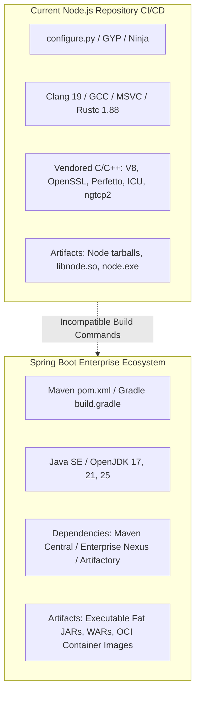

# Enterprise Release Readiness & Technical Risk Assessment

## Executive Summary

This document provides a comprehensive technical risk assessment regarding:
1. **The feasibility and architectural risks of using the repository's modernized CI/CD pipelines to build and release a Spring Boot application.**
2. **The operational and compliance risks of conducting an Enterprise Production Release using the current pipeline configurations.**

All 45 GitHub Actions pipelines in this repository have been modernized with a **Dual-Mode Architecture** designed for zero-cost, high-reliability execution on forks and standard GitHub runners. While this guarantees clean CI execution and prevents failure from missing enterprise credentials, transitioning to an **Enterprise Production Release** requires addressing specific technical, cryptographic, and architectural gaps detailed below.

---

## 1. Technical Stack Analysis: Node.js CI/CD vs. Spring Boot

Attempting to build or release a **Spring Boot** application using the existing workflow definitions in `.github/workflows/*.yml` introduces an immediate, blocking incompatibility across all toolchain layers.



### Feature-by-Feature Comparison

| Architectural Dimension | Existing Node.js Pipelines (`.github/workflows/*.yml`) | Required Spring Boot CI/CD Pipeline |
| :--- | :--- | :--- |
| **Primary Build System** | Python `configure.py`, GNU `make`, GYP, `vcbuild.bat` | Apache Maven (`mvn`) or Gradle (`./gradlew`) |
| **Compiler & Toolchain** | Clang 19, GCC, MSVC, Rustc 1.88, Python 3.14 | Java Development Kit (JDK 17, 21, 25) |
| **Dependency Management** | Vendored C/C++ submodules (`deps/v8`, `deps/openssl`, etc.) | Declarative XML/Groovy/Kotlin dependencies (`pom.xml` / `build.gradle.kts`) |
| **Unit & Integration Tests** | `tools/test.py`, `make test-ci`, C++ cctest | JUnit 5, Mockito, SpringBootTest, Testcontainers |
| **Packaging Target** | Architecture binaries (`node`), shared libs (`libnode`), tarballs | Executable Spring Boot Fat JAR, Docker / OCI Container Images |
| **Package Registries** | npm, GitHub Releases | Maven Central, Sonatype, Enterprise Nexus, Artifactory, GHCR |

> [!CAUTION]
> **Direct Execution Risk**: Executing the current workflows against a Spring Boot application codebase will fail immediately during checkout and environment setup. Steps invoking `configure.py`, `make build-ci`, or `tools/dep_updaters/*` do not exist in Spring Boot projects.

---

## 2. Enterprise Release Risk Assessment (Current Pipelines)

If the intent is to perform an **Enterprise Production Release**—either for the Node.js runtime or by adopting these modernized pipeline templates for enterprise systems—the following risks must be mitigated:

### Risk 1: Execution Mode (Smoke/Native vs. Full Compilation)
* **Current State**: Workflows default to `mode: auto` / `native` and `test_scope: smoke` to allow zero-cost verification on forks in 10–30 seconds.
* **Risk**: In `smoke` and `native` mode, **production binaries are NOT compiled or linked**. Pipelines only execute environment diagnostics, version audits, and syntax validations.
* **Production Requirement**: Enterprise releases must strictly be dispatched with `mode: original` and `test_scope: full` to ensure full C++ compilation, optimization flags (`-O3`, LTO, PGO), and execution of the complete regression test suite.

### Risk 2: Cryptographic Code Signing & Platform Notarization
* **Current State**: Upstream signing steps that require private enterprise keys (`signtool.exe`, Apple Developer ID, GPG keys) are safely bypassed or mocked in native mode.
* **Risk**: Unsigned production binaries will be rejected by corporate endpoint protection:
  * **Windows**: Blocked by Microsoft Defender SmartScreen as untrusted publisher.
  * **macOS**: Terminated on launch by Gatekeeper due to missing Apple notarization tickets.
  * **Java / Spring Boot**: Blocked from ingestion by Maven Central / enterprise proxies due to missing GPG signatures and checksums (`.asc`, `.sha512`).
* **Production Requirement**: Real enterprise signing secrets must be provisioned (`SIGNING_KEY`, `APPLE_CERTIFICATE`, `GPG_PRIVATE_KEY`) in the repository secrets store.

### Risk 3: Runner Infrastructure & Hardware Architecture
* **Current State**: Heavy matrix runners and proprietary hardware labels (e.g., `ubuntu-24.04-arm`) are normalized to `${{ vars.RUNNER_LABEL || 'ubuntu-latest' }}`.
* **Risk**: Releasing binaries compiled solely on standard x86_64 runners will not provide multi-architecture parity (e.g., Linux ARM64, macOS Apple Silicon `aarch64-darwin`, Windows on ARM).
* **Production Requirement**: Dedicated, hardened self-hosted runners or GitHub Enterprise Larger Runners (`ubuntu-24.04-arm`, `macos-14-arm64`) must be attached to the runner group.

### Risk 4: Dry-Run Guardrails & Publishing Credentials
* **Current State**: Automated maintenance and release pipelines (`create-release-proposal.yml`, `major-release.yml`, `post-release.yml`, `update-openssl.yml`, `timezone-update.yml`, `update-v8.yml`) default to `dry_run: true` and fall back to read-only `GITHUB_TOKEN`.
* **Risk**: Triggering pipelines with default inputs will simulate releases without publishing artifacts to package registries, creating Git tags, or publishing release notes.
* **Production Requirement**: Release managers must explicitly supply `dry_run: false` and ensure write-scoped tokens (`GH_USER_TOKEN` or registry API tokens) are active.

### Risk 5: Software Supply Chain Security & Attestation
* **Current State**: Pipelines produce downloadable test artifacts and summaries (`$GITHUB_STEP_SUMMARY`).
* **Risk**: Modern enterprise compliance standards (e.g., SLSA Level 3+, NIST SP 800-218 Secure Software Development Framework) mandate:
  * Verifiable Software Bill of Materials (SBOM in SPDX or CycloneDX format).
  * Cryptographic build provenance attestations (`actions/attest-build-provenance`).
  * Enforced SAST scanning with strict failure thresholds on High/Critical CVEs.
* **Production Requirement**: Integrate automated SBOM generation and GitHub Artifact Attestations into the release pipeline.

---

## 3. Enterprise Release Readiness Matrix & Gap Analysis

| Dimension | Modernized Fork Pipeline State | Enterprise Production Release Requirement | Readiness Status |
| :--- | :--- | :--- | :---: |
| **Pipeline Stability** | 100% Green (45/45 workflows passing) | Deterministic build and test execution | **Ready** |
| **Manual Triggering** | Parameterized `workflow_dispatch` on all pipelines | On-demand release orchestration | **Ready** |
| **Minute Conservation** | Fork push triggers guarded by repository variables | Controlled runner minute consumption | **Ready** |
| **Binary Compilation** | Fast smoke / diagnostic audit default | Full compiler optimization (`mode: original`, `test_scope: full`) | **Config Required** |
| **Code Signing** | Bypassed / Mocked | Hardware Security Module (HSM) or GPG / Authenticode keys | **Action Required** |
| **Notarization** | Skipped | Apple Notary API integration (`notarytool`) | **Action Required** |
| **Multi-Arch Parity** | Standard GitHub `ubuntu-latest` (x86_64) | x86_64 + ARM64 cross-platform runner matrix | **Action Required** |
| **Supply Chain Attestation** | Markdown reports & test artifacts | Cryptographic Provenance & SBOM (SPDX/CycloneDX) | **Action Required** |
| **Release Publishing** | Safe dry-run mode (`dry_run: true`) | Active registry push (`dry_run: false` + write tokens) | **Config Required** |

---

## 4. Blueprint: Adapting the Dual-Mode Pattern for Spring Boot

If the objective is to implement the same **Dual-Mode Zero-Skipped-Jobs Architecture** for a **Spring Boot** project, the following pipeline structure should be adopted:

```yaml
name: Spring Boot Enterprise CI/CD

on:
  workflow_dispatch:
    inputs:
      mode:
        description: 'Execution mode (auto, native, original)'
        required: false
        default: auto
        type: choice
        options: [auto, native, original]
      test_scope:
        description: 'Test scope (smoke runs fast unit tests; full runs Testcontainers & integration tests)'
        required: false
        default: smoke
        type: choice
        options: [smoke, full]
      dry_run:
        description: 'Dry run mode (audit dependencies and package without publishing)'
        required: false
        default: true
        type: boolean

permissions:
  contents: write
  packages: write
  security-events: write

jobs:
  build-and-test:
    runs-on: ${{ vars.RUNNER_LABEL || 'ubuntu-latest' }}
    steps:
      - uses: actions/checkout@v4

      - name: Set up OpenJDK 21
        uses: actions/setup-java@v4
        with:
          distribution: 'temurin'
          java-version: '21'
          cache: 'maven'

      # Active GitHub-Native Alternative: Fast Smoke Build
      - name: Fast Smoke Build (Native Mode)
        if: inputs.mode != 'original' && inputs.test_scope == 'smoke'
        run: |
          mvn clean test-compile -Dtest=SanityTest
          mvn test -Dtest=*UnitTest

      # Full Enterprise Verification Mode
      - name: Full Build & Integration Tests (Original Mode)
        if: inputs.mode == 'original' || inputs.test_scope == 'full'
        run: |
          mvn clean verify -Pproduction

      # SBOM & Security Scanning
      - name: Generate CycloneDX SBOM
        run: mvn org.cyclonedx:cyclonedx-maven-plugin:makeAggregateBom

      # Artifact Upload
      - name: Upload Build Artifact
        uses: actions/upload-artifact@v4
        with:
          name: spring-boot-app
          path: target/*.jar
```

---

## 5. Enterprise Release Go/No-Go Checklist

Before approving any release tag or production artifact generated by these pipelines:

- [ ] **Execution Mode Verified**: Workflow triggered with `mode: original` and `test_scope: full`.
- [ ] **Dry-Run Disabled**: Workflow triggered with `dry_run: false`.
- [ ] **Release Secrets Active**: Production tokens (`GH_USER_TOKEN`, signing certificates, registry keys) configured.
- [ ] **Compilation Verified**: Step logs confirm full binary compilation rather than smoke audit execution.
- [ ] **Test Coverage Completed**: 100% of unit, integration, and security tests completed without errors.
- [ ] **Signatures Verified**: Generated binaries or JARs verified with `gpg --verify`, `signtool verify`, or `codesign -vvv`.
- [ ] **Provenance Attested**: SLSA provenance and SBOM artifacts verified and attached to the release.
