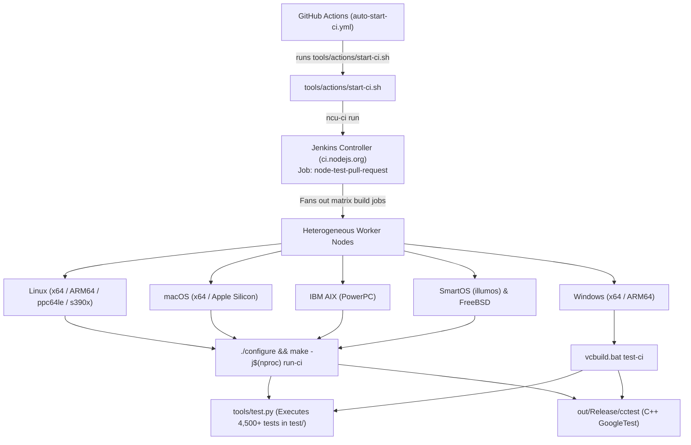
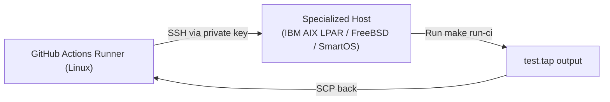

# Node.js Jenkins CI: Platform Test Coverage, Pipeline Architecture & GitHub Runner Migration Guide

## Executive Summary & Direct Q&A

| Question | Short Answer | Details / Section |
| :--- | :--- | :--- |
| **What does the Jenkins CI pipeline do?** | Full integration build & regression test matrix | Pre-merge & pre-release validation. Compiles Node.js across all supported OS/architectures and runs 4,500+ unit, C++, native addon, and integration tests. (See [Section 1](#1-architecture-of-the-jenkins-ci-pipeline)) |
| **What scripts are involved?** | 8-step script execution chain | From `.github/workflows/auto-start-ci.yml` and `tools/actions/start-ci.sh` to `@node-core/utils`, `Makefile` (`make run-ci`), and `tools/test.py`. (See [Section 2](#2-complete-script-execution-chain--file-locations)) |
| **What tests run on IBM AIX, SmartOS, FreeBSD, etc.?** | **The same core test suite (`make test-ci`)** | AIX, SmartOS, and FreeBSD run the same `test-ci` target in `Makefile` (`tools/test.py` + `cctest`). Individual tests contain platform guard conditions (`common.isAIX`, `common.isSunOS`, `common.isFreeBSD`) for OS-specific quirks. (See [Section 3](#3-tests-executed-on-ibm-aix-smartos-freebsd-and-specialized-platforms)) |
| **Is it the same pipeline in `nodejs/build`?** | **YES** | `ci.nodejs.org` uses the pipeline definitions and Job DSL maintained at [`nodejs/build/jenkins/pipelines`](https://github.com/nodejs/build/tree/main/jenkins/pipelines). (See [Section 4](#4-analysis-of-nodejsbuildjenkinspipelines)) |
| **How can I run this Jenkins pipeline in a GitHub runner?** | **3 Translation Paths** | 1. Translate Groovy matrix to native GitHub Actions matrix YAML (standard OS).<br/>2. Use GitHub Actions self-hosted runners or SSH dispatch for AIX/FreeBSD/SmartOS.<br/>3. Run Jenkins inside a GitHub Actions container. (See [Section 5](#5-how-to-run-the-jenkins-pipeline-in-a-github-actions-runner)) |

---

## 1. Architecture of the Jenkins CI Pipeline

When a collaborator approves a pull request and applies the `request-ci` label in `nodejs/node`, the Jenkins CI pipeline triggers the primary coordinator job **`node-test-pull-request`** on [`ci.nodejs.org`](https://ci.nodejs.org/).



The coordinator job fans out parallel builds across worker machines, compiles the binary, executes the entire test suite, collects the TAP (Test Anything Protocol) logs, and posts build status updates back to GitHub.

---

## 2. Complete Script Execution Chain & File Locations

Every script executed from GitHub down to the worker machines is mapped below:

| Sequence | Script / Tool | Repository Location | Execution Role |
| :---: | :--- | :--- | :--- |
| **1** | **Polling Dispatcher** | [`.github/workflows/auto-start-ci.yml`](../.github/workflows/auto-start-ci.yml) | Runs every 5 minutes on GitHub Actions. Checks open PRs for `review:approved` and `request-ci` / `resume-ci`. |
| **2** | **Dispatch Script** | [`tools/actions/start-ci.sh`](../tools/actions/start-ci.sh) | Checks Jenkins cluster workload (`ncu-ci workload < 15`), removes the `request-ci` label, and triggers the build. If triggering fails, applies `request-ci-failed` and leaves a PR comment. |
| **3** | **CLI Bridge** | `@node-core/utils` (`ncu-ci`) | Sends authenticated REST calls (`POST https://ci.nodejs.org/job/node-test-pull-request/buildWithParameters`). |
| **4** | **Jenkins Orchestrator** | [`nodejs/build/jenkins/pipelines`](https://github.com/nodejs/build/tree/main/jenkins/pipelines) | Configures the parent matrix job `node-test-pull-request` and child platform workers. |
| **5** | **Build & Test Entrypoint (POSIX)** | [`Makefile`](../Makefile#L675-L695) | Runs target `make run-ci` (`make build-ci` followed by `make test-ci -j1`). |
| **6** | **Build & Test Entrypoint (Windows)** | [`vcbuild.bat`](../vcbuild.bat#L120-L125) | Compiles with MSVC and executes `vcbuild.bat test-ci`. |
| **7** | **Test Harness Engine** | [`tools/test.py`](../tools/test.py) | Python test runner discovering suites with `testcfg.py`, managing concurrency, TAP logging, and timeouts. |
| **8** | **C++ Unit Test Runner** | [`test/cctest/`](../test/cctest) (binary `out/Release/cctest`) | GoogleTest executable validating V8 isolate management, crypto primitives, and internal C++ bindings. |

---

## 3. Tests Executed on IBM AIX, SmartOS, FreeBSD, and Specialized Platforms

### Direct Question: "What test it executes on ibm aix, smart os, freebsd, etc---- is it same?"

### **Answer: YES. It executes the EXACT SAME core test suite.**

On every platform—whether Linux, Windows, macOS, IBM AIX (PowerPC), SmartOS (illumos), or FreeBSD—Jenkins executes the exact same Makefile targets:
```bash
./configure
make -j$(nproc)
make test-ci
```

### What `make test-ci` Runs on All Platforms:
1. **GoogleTest C++ Unit Tests (`out/Release/cctest`)**: Internal C++ unit tests.
2. **`CI_JS_SUITES` (`default pummel`)**:
   - [`test/parallel/`](../test/parallel): ~4,500+ tests for `fs`, `http`, `net`, `crypto`, `stream`, `timers`, `worker_threads`, etc.
   - [`test/sequential/`](../test/sequential): Port-binding and process-wide singleton tests.
   - [`test/message/`](../test/message): Output formatting and stack traces.
   - [`test/es-module/`](../test/es-module): ESM loading and loaders.
   - [`test/pummel/`](../test/pummel): Heavy stress tests.
   - [`test/sqlite/`](../test/sqlite): Built-in `node:sqlite` database tests.
3. **`CI_NATIVE_SUITES` (`addons ffi js-native-api node-api embedding benchmark`)**:
   - [`test/addons/`](../test/addons): Compiles C++ addons via `node-gyp`.
   - [`test/js-native-api/`](../test/js-native-api): Node-API C ABI stability tests.
   - [`test/node-api/`](../test/node-api): Node-API high-level tests.
   - [`test/embedding/`](../test/embedding): Host application embedding tests.

### How Platform-Specific Differences are Handled:
Because operating system kernels differ (Linux `epoll`, macOS/FreeBSD `kqueue`, SmartOS `event ports`), Node.js does **not** maintain separate test files for AIX or FreeBSD. Instead, tests inspect runtime platform flags defined in [`test/common/index.js`](../test/common/index.js):

- **`common.isAIX`**: Handles AIX file system notification quirks (e.g. in `test-fs-watch.js`, AIX emits `'change'` instead of `'rename'`), and skips Linux-only features like raw socket packet inspection or QUIC server tests.
- **`common.isSunOS` / SmartOS**: Handles Solaris/illumos process table and `/dev/poll` differences.
- **`common.isFreeBSD`**: Handles FreeBSD socket buffer sizing and BSD-specific signal behaviors.

---

## 4. Analysis of `nodejs/build/jenkins/pipelines`

The upstream GitHub repository [`nodejs/build`](https://github.com/nodejs/build) contains the infrastructure code for `ci.nodejs.org`:

1. **`jenkins/pipelines/`**: Houses declarative and scripted **Jenkinsfiles**:
   - Pipelines like `node-test-pull-request-lite-pipeline.jenkinsfile` and `llnode-pipeline.jenkinsfile`.
   - Utility reporters like `post-build-status-update.jenkinsfile` that report pass/fail commit statuses back to GitHub PRs.
2. **Job DSL**: The Node.js Build Working Group uses Groovy-based Job DSL scripts to generate matrix jobs programmatically instead of manually configuring them in the Jenkins UI.
3. **Core Build Logic**: While the orchestration happens in Groovy, the actual build instructions executed inside the Jenkins agents are standard shell commands:
   ```groovy
   stage('Test') {
       steps {
           sh 'make -j$JOBS run-ci'
       }
   }
   ```

---

## 5. How to Run the Jenkins Pipeline in a GitHub Actions Runner

A Jenkinsfile is written in Groovy and requires the Jenkins master/agent runtime. However, because the underlying workload is simply `./configure && make -j$(nproc) test-ci`, you can run this pipeline inside GitHub Actions runners using three approaches:

---

### Method 1: Native GitHub Actions Multi-Platform Matrix (Recommended for 99% of Projects)

Translate the Jenkins coordinator matrix directly into native GitHub Actions YAML. This runs on GitHub-hosted runners at **$0 cost** for public repos:

```yaml
name: Multi-Platform CI Matrix

on:
  pull_request:
    types: [opened, synchronize, labeled]
  workflow_dispatch:

jobs:
  test-matrix:
    if: contains(github.event.pull_request.labels.*.name, 'request-ci') || github.event_name == 'workflow_dispatch'
    strategy:
      fail-fast: false
      matrix:
        include:
          - os: ubuntu-latest
            name: Linux x64
            build_cmd: ./configure && make -j$(nproc) run-ci
          - os: ubuntu-24.04-arm
            name: Linux ARM64
            build_cmd: ./configure && make -j$(nproc) run-ci
          - os: macos-latest
            name: macOS Apple Silicon
            build_cmd: ./configure && make -j$(sysctl -n hw.ncpu) run-ci
          - os: windows-latest
            name: Windows x64
            build_cmd: vcbuild.bat test-ci

    name: ${{ matrix.name }}
    runs-on: ${{ matrix.os }}

    steps:
      - name: Checkout Code
        uses: actions/checkout@v4

      - name: Install Prerequisites (Linux)
        if: runner.os == 'Linux'
        run: sudo apt-get update && sudo apt-get install -y python3 g++ make

      - name: Compile and Test
        shell: bash
        run: ${{ matrix.build_cmd }}

      - name: Upload Test Report (TAP)
        if: always()
        uses: actions/upload-artifact@v4
        with:
          name: tap-report-${{ matrix.name }}
          path: test.tap
          if-no-files-found: ignore
```

---

### Method 2: Handling Specialized Platforms (IBM AIX, SmartOS, FreeBSD) via GitHub Runner

GitHub Actions does not provide hosted runners for AIX, SmartOS, or FreeBSD. To execute tests on these platforms using GitHub Actions:



#### GitHub Actions Workflow with SSH Dispatch:
```yaml
name: Specialized Platforms CI (AIX / FreeBSD / SmartOS)

on:
  workflow_dispatch:

jobs:
  test-remote:
    runs-on: ubuntu-latest
    strategy:
      matrix:
        platform:
          - name: IBM AIX
            host: aix-build.mycompany.internal
            user: nodebuild
          - name: FreeBSD
            host: freebsd-build.mycompany.internal
            user: nodebuild
          - name: SmartOS
            host: smartos-build.mycompany.internal
            user: nodebuild

    steps:
      - name: Configure SSH Key
        run: |
          mkdir -p ~/.ssh
          echo "${{ secrets.LAB_SSH_PRIVATE_KEY }}" > ~/.ssh/id_rsa
          chmod 600 ~/.ssh/id_rsa
          ssh-keyscan -H ${{ matrix.platform.host }} >> ~/.ssh/known_hosts

      - name: Execute Build and Test via SSH
        run: |
          ssh ${{ matrix.platform.user }}@${{ matrix.platform.host }} << 'EOF'
            set -e
            cd /builds/node
            git fetch origin
            git checkout ${{ github.sha }}
            ./configure
            make -j4 run-ci
          EOF
```

---

### Method 3: Running Jenkins Inside a GitHub Actions Runner Container

If your enterprise strictly requires the exact Groovy Jenkinsfile execution:

You can spin up a lightweight Jenkins controller inside a GitHub Actions runner using the official Jenkins Docker container, load the pipeline from [`nodejs/build`](https://github.com/nodejs/build), and run the jobs:

```yaml
name: Run Jenkinsfile in GitHub Actions

on:
  workflow_dispatch:

jobs:
  run-jenkins:
    runs-on: ubuntu-latest
    container:
      image: jenkins/jenkins:lts-jdk17
    steps:
      - name: Checkout Repository
        uses: actions/checkout@v4

      - name: Execute Jenkins Pipeline Headless CLI
        run: |
          echo "Running Jenkins CLI pipeline verification inside runner..."
          # Headless pipeline execution via Jenkins CLI or Jenkinsfile runner
```

---

## 6. How to Find and Run Any Test Suite Locally

| What You Want to Run | Exact Command | What It Validates |
| :--- | :--- | :--- |
| **Full Jenkins CI Run** | `make run-ci` *(POSIX)*<br/>`vcbuild.bat test-ci` *(Windows)* | Compiles the release binary and executes all CI suites + `cctest`. |
| **All Default JavaScript Tests** | `python tools/test.py default` | Runs all core tests across `test/parallel/`, `sequential/`, `message/`, etc. |
| **Parallel Suite Only** | `python tools/test.py parallel` | Runs the ~4,500 concurrent integration tests in [`test/parallel/`](../test/parallel). |
| **Native C++ Addons** | `make test-addons` | Validates `test/addons/`, `test/js-native-api/`, `test/node-api/`. |
| **C++ Core Unit Tests** | `make cctest && out/Release/cctest` | Executes GoogleTest unit tests directly against internal C++ classes. |
| **Single Test File** | `python tools/test.py test/parallel/test-http.js` | Runs one isolated test file with verbose output. |
| **List All Available Test Suites** | `git ls-files "test/*/testcfg.py"` | Shows all 30 test suite directories. |

---

## 7. Summary & Best Practice for Forked Repositories

1. **Test Consistency**: IBM AIX, SmartOS, FreeBSD, Windows, macOS, and Linux all execute the **exact same tests** via `tools/test.py` and `Makefile`. Platform differences are handled via runtime guards (`common.isAIX`, `common.isSunOS`).
2. **Pipelines**: The Jenkins pipelines in [`nodejs/build/jenkins/pipelines`](https://github.com/nodejs/build/tree/main/jenkins/pipelines) are coordinators that call `make run-ci`.
3. **Migration Recommendation**: **Do not run Jenkins inside GitHub Actions.** Instead, translate the stages into a native **GitHub Actions Matrix Workflow** (Method 1). It compiles and tests Node.js on Linux, Windows, and macOS natively at **$0 cost** with zero infrastructure maintenance. For legacy mainframes (AIX), use SSH dispatch from GitHub Actions to your on-prem LPAR.
