# Node.js Architecture – Component Tiers

This document details the architectural component tiers of the **Node.js** runtime project, modeled directly on the tiered subsystem architecture format (Foundation, Core Components, Ecosystem Plugins, and Engineering Tools).

All components and tools listed below have been verified against actual codebase artifacts in `c:\projects\node`.

---

## 1. Visual Architecture Diagram (Component Tiers)

```
┌────────────────────────────────────────────────────────────────────────────────────────────────────────┐
│                                Node.js Architecture – Component Tiers                                  │
├────────────────────────────────────────────────────────────────────────────────────────────────────────┤
│                                                                                                        │
│   ┌───────────────────────────┐   ╔════════════════════════════════════════════════════════════════╗   │
│   │ Tier-1: Foundation &      │   ║ ┌───────┐ ┌─────────┐ ┌─────────┐ ┌────────┐ ┌─────────┐       ║   │
│   │ Core Subsystems           │   ║ │  V8   │ │  libuv  │ │ OpenSSL │ │ llhttp │ │ nghttp2 │  ...  ║   │
│   │ (Upstream Dependencies)   │   ║ └───────┘ └─────────┘ └─────────┘ └────────┘ └─────────┘       ║   │
│   └───────────────────────────┘   ╚════════════════════════════════════════════════════════════════╝   │
│                                                                                                        │
│   ┌───────────────────────────┐   ╔════════════════════════════════════════════════════════════════╗   │
│   │ Tier-2: Node.js Core      │   ║ ┌───────┐ ┌─────────┐ ┌─────────┐ ┌────────┐ ┌─────────┐       ║   │
│   │ Components                │   ║ │ node  │ │ libnode │ │ Env/VM  │ │ JS Lib │ │Node-API│  ...  ║   │
│   │ (Project-Owned)           │   ║ └───────┘ └─────────┘ └─────────┘ └────────┘ └─────────┘       ║   │
│   └───────────────────────────┘   ╚════════════════════════════════════════════════════════════════╝   │
│                                                                                                        │
│   ┌───────────────────────────┐   ╔════════════════════════════════════════════════════════════════╗   │
│   │ Tier-3: Ecosystem Plugins │   ║ ┌───────┐ ┌─────────┐ ┌─────────┐ ┌────────┐ ┌─────────┐       ║   │
│   │ & Bundled Tools           │   ║ │  npm  │ │corepack │ │ undici  │ │ amaro  │ │  acorn  │  ...  ║   │
│   │ (Open Source Integrations)│   ║ └───────┘ └─────────┘ └─────────┘ └────────┘ └─────────┘       ║   │
│   └───────────────────────────┘   ╚════════════════════════════════════════════════════════════════╝   │
│                                                                                                        │
│   ┌───────────────────────────┐   ╔════════════════════════════════════════════════════════════════╗   │
│   │ Tier-4: Engineering &     │   ║ ┌───────┐ ┌─────────┐ ┌─────────┐ ┌────────┐ ┌─────────┐       ║   │
│   │ CI/CD Tools               │   ║ │test.py│ │   WPT   │ │ GYP/Cfg │ │ ESLint │ │Perfetto│  ...  ║   │
│   │ (Quality & Build Infra)   │   ║ └───────┘ └─────────┘ └─────────┘ └────────┘ └─────────┘       ║   │
│   └───────────────────────────┘   ╚════════════════════════════════════════════════════════════════╝   │
│                                                                                                        │
└────────────────────────────────────────────────────────────────────────────────────────────────────────┘

LEGEND:
  ┌──────────────────────────────────────────────┐       ┌──────────────────────────────────────────────┐
  │ 🟩 Node.js Core Components (Project-Owned)   │       │ 🟦 Dependent Third-Party (3P) Components     │
  └──────────────────────────────────────────────┘       └──────────────────────────────────────────────┘
```

### Mermaid Diagram Representation

```mermaid
graph LR
    classDef nodeOwned fill:#008080,stroke:#004d40,stroke-width:2px,color:#ffffff,font-weight:bold;
    classDef thirdParty fill:#0099ff,stroke:#0066cc,stroke-width:2px,color:#ffffff,font-weight:bold;
    classDef tierPill fill:#006699,stroke:#004466,stroke-width:2px,color:#ffffff,font-weight:bold;
    classDef container fill:#f4fbfb,stroke:#008080,stroke-width:2px,stroke-dasharray: 5 5;

    subgraph Tier1_Box ["Tier-1: Foundation Subsystems"]
        T1_Pill["Tier-1: Foundation & Low-Level Subsystems"]:::tierPill
        subgraph T1_Items [" "]
            T1_1["Google V8"]:::thirdParty
            T1_2["libuv"]:::thirdParty
            T1_3["OpenSSL"]:::thirdParty
            T1_4["llhttp"]:::thirdParty
            T1_5["nghttp2 / ngtcp2"]:::thirdParty
            T1_6["zlib / zstd / brotli"]:::thirdParty
            T1_7["c-ares"]:::thirdParty
            T1_8["ICU (Unicode)"]:::thirdParty
        end
    end

    subgraph Tier2_Box ["Tier-2: Node.js Core Components"]
        T2_Pill["Tier-2: Node.js Core Components"]:::nodeOwned
        subgraph T2_Items [" "]
            T2_1["node CLI Binary"]:::nodeOwned
            T2_2["libnode Shared API"]:::nodeOwned
            T2_3["Environment Coordinator"]:::nodeOwned
            T2_4["C++ Internal Bindings"]:::nodeOwned
            T2_5["JS Standard Library"]:::nodeOwned
            T2_6["Node-API (N-API)"]:::nodeOwned
            T2_7["Inspector Agent"]:::nodeOwned
            T2_8["Permission Model"]:::nodeOwned
            T2_9["node:sqlite"]:::nodeOwned
            T2_10["SEA (Single Executable)"]:::nodeOwned
        end
    end

    subgraph Tier3_Box ["Tier-3: Ecosystem Plugins & Bundled Tools"]
        T3_Pill["Tier-3: Ecosystem Plugins & Bundled Tools"]:::tierPill
        subgraph T3_Items [" "]
            T3_1["npm"]:::thirdParty
            T3_2["Corepack"]:::thirdParty
            T3_3["undici (fetch / WS)"]:::thirdParty
            T3_4["amaro (TypeScript)"]:::thirdParty
            T3_5["acorn (AST Parser)"]:::thirdParty
            T3_6["ada & simdjson"]:::thirdParty
            T3_7["uvwasi (WASI)"]:::thirdParty
        end
    end

    subgraph Tier4_Box ["Tier-4: Engineering & CI/CD Tools"]
        T4_Pill["Tier-4: Engineering & CI/CD Tools"]:::tierPill
        subgraph T4_Items [" "]
            T4_1["tools/test.py"]:::nodeOwned
            T4_2["Web Platform Tests (WPT)"]:::thirdParty
            T4_3["configure.py & GYP"]:::nodeOwned
            T4_4["Benchmark Suite"]:::nodeOwned
            T4_5["ESLint & Prettier"]:::thirdParty
            T4_6["clang-format & cpplint"]:::thirdParty
            T4_7["Google Perfetto"]:::thirdParty
            T4_8["Mozilla sccache"]:::thirdParty
            T4_9["License Builder"]:::nodeOwned
            T4_10["CodeQL & Scorecard"]:::thirdParty
        end
    end

    class T1_Items,T2_Items,T3_Items,T4_Items container;
```



---

## 2. Complete Architectural Component Data Table

| Tier | Component Name | Classification | Primary Purpose & Architectural Role | Use Case in Node.js | Verified Codebase Path |
| :--- | :--- | :--- | :--- | :--- | :--- |
| **Tier-1** | **Google V8** | Dependent 3P Component | High-performance ECMAScript & WebAssembly engine, TurboFan JIT compiler, and garbage collection. | Executes all JavaScript and WebAssembly code; provides V8 heap and isolate management. | [`deps/v8/src/api/api.cc`](deps/v8/src/api/api.cc) |
| **Tier-1** | **libuv** | Dependent 3P Component | Multi-platform asynchronous I/O engine, event loop abstraction (epoll/kqueue/IOCP), and OS thread pool. | Drives the Node.js event loop, non-blocking network sockets, file system threads, and timers. | [`deps/uv/src/unix/core.c`](deps/uv/src/unix/core.c) |
| **Tier-1** | **OpenSSL & ncrypto** | Dependent 3P Component | Cryptographic primitives, TLS 1.2/1.3 protocol implementation, X.509 certificates, and FIPS engine. | Powers `node:crypto`, `node:tls`, HTTPS communication, hashing, signing, and cipher streams. | [`deps/openssl/openssl/crypto/evp/evp_enc.c`](deps/openssl/openssl/crypto/evp/evp_enc.c) |
| **Tier-1** | **llhttp** | Dependent 3P Component | Ultra-fast, zero-copy HTTP/1.1 request and response protocol parser. | Parses incoming HTTP request headers, chunked transfer encoding, and HTTP response messages. | [`deps/llhttp/src/llhttp.c`](deps/llhttp/src/llhttp.c) |
| **Tier-1** | **nghttp2** | Dependent 3P Component | HTTP/2 protocol binary framing, stream multiplexing, and HPACK header compression. | Core protocol engine for `node:http2` server and client implementations. | [`deps/nghttp2/lib/nghttp2_session.c`](deps/nghttp2/lib/nghttp2_session.c) |
| **Tier-1** | **ngtcp2 & nghttp3** | Dependent 3P Component | IETF QUIC transport protocol and HTTP/3 binary protocol implementation. | Implements experimental QUIC UDP transport and HTTP/3 protocol stacks in Node core. | [`deps/ngtcp2/ngtcp2/lib/ngtcp2_conn.c`](deps/ngtcp2/ngtcp2/lib/ngtcp2_conn.c) |
| **Tier-1** | **zlib / zstd / brotli** | Dependent 3P Component | Stream compression and decompression algorithms (Deflate/Gzip, Zstandard, and Brotli). | Powers `node:zlib` module for compressed network transfers and file archiving. | [`deps/zlib/deflate.c`](deps/zlib/deflate.c), [`deps/zstd/lib/compress/zstd_compress.c`](deps/zstd/lib/compress/zstd_compress.c), [`deps/brotli/c/dec/decode.c`](deps/brotli/c/dec/decode.c) |
| **Tier-1** | **c-ares** | Dependent 3P Component | Asynchronous DNS resolver C library for non-blocking name queries. | Powers asynchronous DNS lookups in `node:dns` (`dns.resolve*`) without blocking threadpool. | [`deps/cares/src/lib/ares_init.c`](deps/cares/src/lib/ares_init.c) |
| **Tier-1** | **ICU (International Components for Unicode)** | Dependent 3P Component | Unicode internationalization (i18n), collation, date/time formatting, and IANA timezone database. | Implements ECMAScript `Intl` API, locale-aware string comparisons, and timezone translations. | [`deps/icu-small/source/common/unicode/uchar.h`](deps/icu-small/source/common/unicode/uchar.h) |
| **Tier-1** | **Ada & simdjson** | Dependent 3P Component | SIMD-accelerated WHATWG URL parser and high-throughput JSON processing primitives. | Implements compliant, ultra-fast `WHATWG URL` parsing and JSON stream acceleration. | [`deps/ada/ada.cpp`](deps/ada/ada.cpp), [`deps/simdjson/simdjson.cpp`](deps/simdjson/simdjson.cpp) |
| **Tier-2** | **node CLI & libnode** | Node.js Core Component (Project-Owned) | Main CLI entrypoint executable and embeddable C++ shared library API. | Starts the Node.js process, parses CLI flags, evaluates entry scripts, and embeds Node in host apps. | [`src/node_main.cc`](src/node_main.cc), [`src/node.cc`](src/node.cc) |
| **Tier-2** | **Environment Coordinator** | Node.js Core Component (Project-Owned) | `node::Environment` & `node::NodePlatform` binding V8 Isolate turns to the libuv event loop. | Manages active handles, microtask checkpoints, async ID contexts, and process life-cycle. | [`src/env.cc`](src/env.cc), [`src/node_platform.cc`](src/node_platform.cc) |
| **Tier-2** | **C++ Internal Bindings** | Node.js Core Component (Project-Owned) | Native C++ classes bridging OS system calls and C/C++ libraries into JavaScript. | Implements native bindings for file I/O, cryptography, networking, IPC, and buffers. | [`src/node_file.cc`](src/node_file.cc), [`src/node_crypto.cc`](src/node_crypto.cc), [`src/node_buffer.cc`](src/node_buffer.cc), [`src/async_wrap.cc`](src/async_wrap.cc) |
| **Tier-2** | **JavaScript Standard Library** | Node.js Core Component (Project-Owned) | Pure JavaScript built-in standard library exposed to developers. | Standard APIs: `fs`, `net`, `http`, `stream`, `events`, `child_process`, `worker_threads`, `cluster`. | [`lib/fs.js`](lib/fs.js), [`lib/net.js`](lib/net.js), [`lib/http.js`](lib/http.js), [`lib/stream.js`](lib/stream.js), [`lib/crypto.js`](lib/crypto.js) |
| **Tier-2** | **Node-API (N-API)** | Node.js Core Component (Project-Owned) | Application Binary Interface (ABI) stable C interface for native C/C++ addons. | Allows third-party native addons to run without recompilation across major Node.js versions. | [`src/node_api.cc`](src/node_api.cc), [`src/js_native_api.cc`](src/js_native_api.cc) |
| **Tier-2** | **V8 Inspector Protocol Agent** | Node.js Core Component (Project-Owned) | Embedded Chrome DevTools Protocol debugging server and CPU/memory profiling agent. | Powers `--inspect`, live breakpoint debugging, CPU performance profiling, and heap snapshots. | [`src/inspector_agent.cc`](src/inspector_agent.cc), [`src/inspector/`](src/inspector/) |
| **Tier-2** | **Permission Model & Security Policies** | Node.js Core Component (Project-Owned) | Runtime security sandbox controlling filesystem access, child processes, and network requests. | Enforces `--permission`, `--allow-fs-read`, and security integrity policies at runtime. | [`src/permission/permission.cc`](src/permission/permission.cc) |
| **Tier-2** | **Built-in SQLite Engine** | Node.js Core Component (Project-Owned) | Integrated zero-configuration embedded relational database engine. | Powers the built-in `node:sqlite` module without requiring external native dependencies. | [`src/node_sqlite.cc`](src/node_sqlite.cc), [`deps/sqlite/sqlite3.c`](deps/sqlite/sqlite3.c) |
| **Tier-2** | **Single Executable Applications (SEA)** | Node.js Core Component (Project-Owned) | Engine for bundling JavaScript scripts and assets into a single standalone native binary. | Allows distributing self-contained Node.js applications using `postject` binary injection. | [`src/node_sea.cc`](src/node_sea.cc), [`deps/postject/`](deps/postject/) |
| **Tier-3** | **npm** | Dependent 3P Component / Ecosystem Tool | Official default package manager for the global Node.js and JavaScript ecosystem. | Resolves, installs, and manages third-party open-source packages and scripts for projects. | [`deps/npm/package.json`](deps/npm/package.json) |
| **Tier-3** | **Corepack** | Dependent 3P Component / Ecosystem Tool | Zero-install bridge and version manager for alternative package managers. | Transparently downloads and executes matching versions of `yarn`, `pnpm`, and `npm`. | [`deps/corepack/package.json`](deps/corepack/package.json) |
| **Tier-3** | **undici** | Dependent 3P Component / Ecosystem Tool | Next-generation high-performance HTTP/1.1 client, WHATWG `fetch()`, and `WebSocket` implementation. | Drives global `fetch()`, `Request`, `Response`, `FormData`, and `WebSocket` in Node core. | [`deps/undici/undici.js`](deps/undici/undici.js) |
| **Tier-3** | **amaro** | Dependent 3P Component / Ecosystem Tool | Fast TypeScript type-stripping transform engine (based on SWC). | Enables running TypeScript files directly in Node.js via `--experimental-strip-types`. | [`deps/amaro/package.json`](deps/amaro/package.json), [`src/amaro_version.h`](src/amaro_version.h) |
| **Tier-3** | **acorn & acorn-walk** | Dependent 3P Component / Ecosystem Tool | In-engine ECMAScript abstract syntax tree (AST) parser. | Parses JavaScript syntax in the interactive REPL and analyzes module dependencies. | [`deps/acorn/acorn/`](deps/acorn/acorn/) |
| **Tier-3** | **uvwasi** | Dependent 3P Component / Ecosystem Tool | WebAssembly System Interface (WASI) implementation built on top of libuv. | Provides standard OS system call interfaces (file I/O, clocks, environment) to Wasm binaries. | [`deps/uvwasi/src/uvwasi.c`](deps/uvwasi/src/uvwasi.c) |
| **Tier-3** | **inspector_protocol** | Dependent 3P Component / Ecosystem Tool | Chrome DevTools protocol schema and code-generation templates. | Generates protocol handlers and JSON serialization for debugger and profiler messages. | [`deps/inspector_protocol/README.md`](deps/inspector_protocol/README.md) |
| **Tier-4** | **tools/test.py** | Node.js Project Tool (Project-Owned) | Primary Python test orchestration harness for Node.js test suites. | Executes parallel, sequential, message, addons, and native unit tests across platforms. | [`tools/test.py`](tools/test.py) |
| **Tier-4** | **Web Platform Tests (WPT)** | Dependent 3P Tool (W3C Standard) | W3C web standards conformance test harness. | Validates compatibility with browser engines for WHATWG URL, Fetch, Streams, and WebCrypto. | [`test/wpt/README.md`](test/wpt/README.md) |
| **Tier-4** | **configure.py & GYP** | Node.js Project Tool (Project-Owned) | Cross-platform meta-build generator and compiler configuration tool. | Generates Ninja, Makefiles, and Visual Studio solution files for multi-OS compilation. | [`configure.py`](configure.py), [`tools/gyp/`](tools/gyp/) |
| **Tier-4** | **Benchmark Suite** | Node.js Project Tool (Project-Owned) | Performance micro-benchmarking harness measuring throughput, latency, and memory. | Measures regressions and optimizations in HTTP, buffers, crypto, streams, and async hooks. | [`benchmark/run.js`](benchmark/run.js), [`benchmark/`](benchmark/) |
| **Tier-4** | **ESLint & Prettier** | Dependent 3P Tool (Ecosystem) | Static JavaScript/TypeScript code analysis, linting, and formatting rules. | Enforces code style, catches common errors, and verifies JavaScript standards in core and tests. | [`tools/eslint/package.json`](tools/eslint/package.json) |
| **Tier-4** | **clang-format & cpplint** | Dependent 3P Tool (LLVM / Google) | C++ code style checker and automatic formatter following Google C++ standards. | Formats and lints C/C++ engine code in `src/` to prevent style and syntax regressions. | [`tools/clang-format/package.json`](tools/clang-format/package.json), [`tools/cpplint.py`](tools/cpplint.py) |
| **Tier-4** | **Google Perfetto** | Dependent 3P Tool (Google) | High-performance system-wide event tracing and kernel-level performance profiler. | Instruments Node.js internal trace points and exports traces for Chrome DevTools analysis. | [`tools/perfetto/get_trace_processor`](tools/perfetto/get_trace_processor), [`deps/perfetto/`](deps/perfetto/) |
| **Tier-4** | **Mozilla sccache** | Dependent 3P Tool (Mozilla) | Shared, distributed compiler cache for C and C++ compilation. | Accelerates CI build times across GitHub Actions and Jenkins by avoiding redundant compilation. | [`.github/workflows/test-linux.yml`](.github/workflows/test-linux.yml) |
| **Tier-4** | **License Builder & Auditor** | Node.js Project Tool (Project-Owned) | Automated license scanner and legal attestation generator. | Audits licenses of all vendored 3P dependencies and compiles the official `LICENSE` file. | [`tools/license-builder.sh`](tools/license-builder.sh), [`.github/workflows/license-builder.yml`](.github/workflows/license-builder.yml) |
| **Tier-4** | **CodeQL & OpenSSF Scorecard** | Dependent 3P Tool (GitHub / OpenSSF) | Static application security testing (SAST) and supply-chain security score calculator. | Identifies vulnerabilities (CWE/CVE), verifies build security, and guards branch protection. | [`.github/workflows/codeql.yml`](.github/workflows/codeql.yml), [`.github/workflows/scorecard.yml`](.github/workflows/scorecard.yml) |

---

## 3. Structural Comparison: K3s Reference Model vs. Node.js Architecture

| Architectural Tier | K3s Reference Model (`media_1793687894403_8a38abe3.png`) | Node.js Architectural Mapping | Dominant Ownership Classification |
| :--- | :--- | :--- | :--- |
| **Tier-1** | **K8s Core components**<br>(Spring Boot, Kube-Proxy, runc, containerd) | **Foundation & Low-Level Subsystems**<br>(Google V8, libuv, OpenSSL, llhttp, nghttp2, zlib, c-ares) | **Dependent Third-Party (3P) Components** (Vendored in `deps/`) |
| **Tier-2** | **K3s Components**<br>(k3s, Helm-Controller, Klipper-lb) | **Node.js Core Components**<br>(`node` CLI, `libnode`, Environment, C++ Bindings, JS StdLib, Node-API, Inspector) | **Node.js Core Components (Project-Owned)** (Authored in `src/` & `lib/`) |
| **Tier-3** | **Ecosystem Plugins (Open Sources)**<br>(Flannel, Metrics-server, Traefik) | **Ecosystem Plugins & Bundled Tools**<br>(npm, Corepack, undici, amaro, acorn, uvwasi, ada/simdjson) | **Dependent Third-Party (3P) / Bundled Open Source** |
| **Tier-4** | **Engineering Tools**<br>(Dapper, Sonobuoy, Gomega) | **Engineering & CI/CD Tools**<br>(`tools/test.py`, WPT, `configure.py`/GYP, Benchmark, ESLint, clang-format, Perfetto, sccache) | **Mix**: Project-Owned Test/Build + Dependent 3P Linters & Profilers |

---

## 4. Key Takeaways & Architectural Highlights

1. **Clean Separation of Concerns**:
   - **Tier-1** provides the raw compute, memory, and OS primitives (V8 for bytecode execution, libuv for asynchronous I/O, OpenSSL for cryptographic security).
   - **Tier-2** coordinates and surfaces these low-level engines into an ergonomic, event-driven JavaScript developer API (`fs`, `net`, `http`, `crypto`, `worker_threads`).
   - **Tier-3** equips the developer with modern standards and package tooling (`npm`, `corepack`, `fetch` via `undici`, TypeScript via `amaro`).
   - **Tier-4** safeguards code quality, performance regressions, standards compliance (W3C WPT), and continuous verification across all platforms.

2. **Dual-Classification Legend**:
   - 🟩 **Node.js Core Components (Project-Owned)**: Conceived, maintained, and copyrighted by the Node.js project / OpenJS Foundation.
   - 🟦 **Dependent Third-Party (3P) Components**: Upstream open-source libraries vendored or integrated to maintain velocity and adhere to global industry standards.
