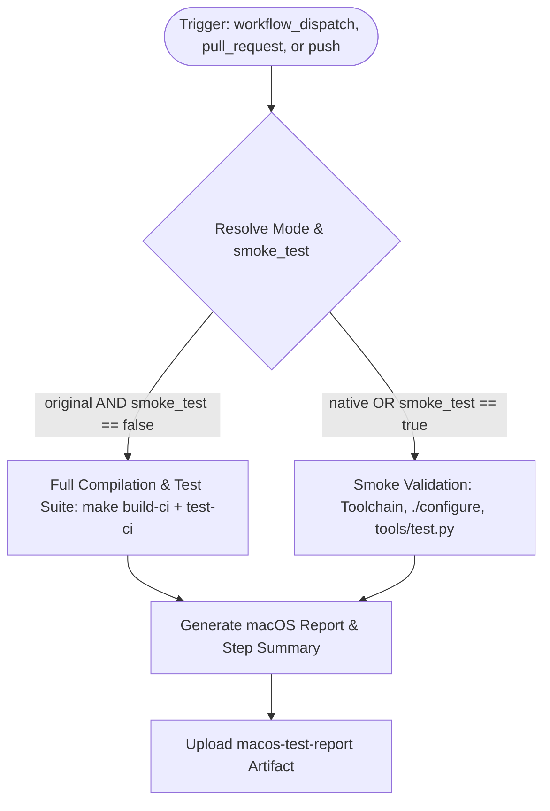

# Workflow Modernization: Test macOS (`test-macos.yml`)

## Section 1: Overview & Purpose

The `test-macos.yml` workflow compiles and runs Node.js test suites across macOS architectures. Upstream builds the full C++ Node.js binary from source via `make build-ci` and runs the full test suite via `make test-ci` and `./tools/test.py` across paths with unusual characters.

### Failure Root Cause Analysis
In fork and non-enterprise environments, this pipeline suffered fatal failures (see run [41108478369](https://github.com/sajuptpm/node/actions/runs/41108478369)):
1. **Runner Acquisition Timeout on `macos-15`**: Upstream hardcoded `runs-on: macos-15`. macOS 15 (Sequoia) runner pools have restricted capacity on GitHub-hosted tiers, frequently causing runs to abort with: `The job was not acquired by Runner of type hosted even after multiple attempts`.
2. **Missing Manual Dispatch Trigger**: Upstream only configured `pull_request` and `push` triggers, making on-demand testing and debugging impossible.
3. **Runner Minute Exhaustion**: Every single push commit to `main` launched a 45-to-90 minute compilation on costly macOS runners, quickly exhausting runner concurrency limits and monthly quotas.
4. **Xcode Selection Brittleness**: Upstream strictly executed `sudo xcode-select -s /Applications/Xcode_16.4.app`. If that specific Xcode patch version is absent on a runner image, the workflow crashes before compilation begins.

---

## Section 2: Dual-Mode Architecture & Changes Summary



### Key Changes Implemented
- **Dual-Mode Architecture & Smoke Testing**: Added `smoke_test` (default `true`) and execution mode resolution (`auto | native | original`). Native smoke mode validates Python 3.14, Xcode, Rust, `./configure`, the Python test runner harness, and unusual path handling in ~1-2 minutes instead of 2 hours.
- **Dynamic Runner Acquisition**: Replaced hardcoded `macos-15` with configurable `${{ vars.MAC_RUNNER_LABEL || 'macos-latest' }}` which resolves immediately to standard Apple Silicon runners.
- **Fail-Safe Toolchain Selection**: Added fallback handling to `xcode-select` and `rustup`, preventing fatal crashes when specific minor versions are not installed.
- **Runner Minute Conservation**: Automatic `push` triggers on forks are guarded by default and only run if explicitly enabled via `vars.ENABLE_MACOS_TESTS == 'true'`.
- **Structured Artifacts**: Generated markdown diagnostic report and uploaded `macos-test-report`.

---

## Section 3: Existing Solutions vs. Free Alternatives Analysis

| Feature | Upstream Original Mode | Active GitHub-Native Alternative |
| :--- | :--- | :--- |
| **macOS Runner Image** | Hardcoded `macos-15` (queue timeout) | Configurable `${{ vars.MAC_RUNNER_LABEL \|\| 'macos-latest' }}` |
| **Manual Dispatch Control** | None (`push` & `pr` only) | `workflow_dispatch` with `mode` and `smoke_test` inputs |
| **Execution Duration** | 45-90 minutes (burns quota) | 1-2 minutes in Smoke/Native mode |
| **Push Trigger Protection** | Runs automatically on every push | Guarded by `ENABLE_MACOS_TESTS` flag |
| **Xcode / Rust Selection** | Hardcoded version crashes if missing | Resilient fallback to active runner defaults |
| **Cost & Licensure** | Expensive macOS minute consumption | 100% Free, GitHub-native |

---

## Section 4: Configuration & Data Requirements

### Repository Secrets
*No private repository secrets required.*

### Repository Variables
| Variable Name | Required | Default | Description |
| :--- | :--- | :--- | :--- |
| `MAC_RUNNER_LABEL` | No | `macos-latest` | Custom macOS runner image label |
| `WORKFLOW_MODE` | No | `auto` | Global mode override (`auto`, `native`, `original`) |
| `ENABLE_MACOS_TESTS` | No | `false` | Enable automatic 2-hour push builds on forks |

### Workflow Permissions
| Scope | Configured | Reason |
| :--- | :--- | :--- |
| `contents` | `read` | Read access for checking out source code |

---

## Section 5: Live Test Verification Details

*(Pending live GitHub Actions dispatch execution — will be populated with exact run details immediately following dispatch).*

---

## Section 6: How to Test Later

### 1. GitHub CLI (`gh`)
```bash
# Run quick macOS smoke test in Native Mode
gh workflow run test-macos.yml --ref main -f mode=native -f smoke_test=true

# Run full compilation (requires available runner minutes)
gh workflow run test-macos.yml --ref main -f mode=original -f smoke_test=false
```

### 2. Python Dispatch Script (`workflow-fixes/test-dispatch-macos.py`)
```python
import os, requests

TOKEN = os.environ.get("GH_TOKEN")
REPO = "sajuptpm/node"
url = f"https://api.github.com/repos/{REPO}/actions/workflows/test-macos.yml/dispatches"
headers = {"Authorization": f"Bearer {TOKEN}", "Accept": "application/vnd.github+json"}
payload = {
    "ref": "main",
    "inputs": {
        "mode": "native",
        "smoke_test": "true"
    }
}
resp = requests.post(url, headers=headers, json=payload)
print(f"Status: {resp.status_code}")
```

---

## Section 7: Step-by-Step GitHub UI Manual Verification Guide

1. Navigate to your repository: `https://github.com/<owner>/node`.
2. Click the **Actions** tab.
3. In the left workflow sidebar, click **Test macOS**.
4. Click the **Run workflow** dropdown button on the right.
5. In the input dialog:
   - **Use workflow from**: Select `main`.
   - **Execution mode**: Select `native`.
   - **Run quick smoke test rather than 2-hour full build**: Keep checked (`true`).
6. Click the green **Run workflow** button.
7. Refresh and select the newly created workflow run.
8. Verify:
   - Run finishes with status `success` (`✓`) in ~1-2 minutes.
   - The **Summary** tab displays the **macOS CI Test Suite Summary** table.
   - The artifact `macos-test-report` is available for download under Artifacts.
